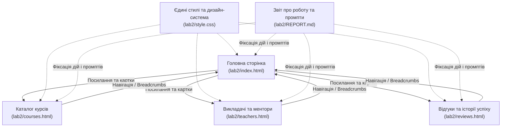

# План виконання: Лабораторна робота №2 (каталог `lab2/`)

## Опис мети
Мета роботи — набути практичних навичок розробки сучасних адаптивних веб-сторінок з використанням HTML5, CSS3 та фреймворку Bootstrap 5, а також опанувати методи ефективної роботи з Google Gemini для генерації, оптимізації та адаптації коду.

На даний момент у каталозі `lab2/` реалізовано базову односторінкову структуру (`index.html`, `style.css`) для школи мов **"Polyglot Academy"** (Етапи 1–2).
Відповідно до інструкції користувача:
1. Робоча область обмежена виключно каталогом `lab2/`.
2. За секціями курсів, викладачів та відгуків студентів розробляються **додаткові детальні сторінки**:
   - `courses.html` — розширений каталог курсів з фільтрацією, рівнями (A1–C2, IELTS/TOEFL) та силабусом.
   - `teachers.html` — каталог викладачів та носіїв мови з детальними біографіями, сертифікаціями та розкладом.
   - `reviews.html` — сторінка відгуків студентів, історій успіху, відеовідгуків та інтерактивної форми зворотного зв'язку.
3. Оновлюється головна сторінка `index.html` (навігація, кнопки переходів «Детальніше», «Всі викладачі», «Всі курси»).
4. Оновлюється та уніфікується `style.css` для збереження єдиної дизайн-системи.
5. Усі запити, згенеровані рішення, правки та результати тестування фіксуються в детальному звіті `lab2/REPORT.md`.

---

## Необхідно підтвердження користувача

> [!IMPORTANT]
> **Організація багатосторінкової навігації:**
> Всі сторінки (`index.html`, `courses.html`, `teachers.html`, `reviews.html`) матимуть спільний єдиний адаптивний `navbar` та `footer`, навігаційні хлібні крихти (`breadcrumb`), а також спільний файл стилів `style.css` без порушення існуючої логіки головної сторінки.

---

## Запитання та пропозиції

> [!NOTE]
> 1. Чи затверджуєте ви структуру з трьома новими сторінками: `courses.html`, `teachers.html`, `reviews.html`?
> 2. Усі запити та згенеровані промпти фіксуватимуться в `lab2/REPORT.md` українською мовою з детальним описом етапів згідно з методичними вказівками.

---

## Запропоновані зміни

### 1. Документування та звітність
#### [NEW] `lab2/REPORT.md`
Створення повноцінного структурованого звіту:
- Тема, мета, завдання роботи.
- Етап 1: Підготовка та ініціалізація структури.
- Етап 2: Промпти до Google Gemini для генерації коду кожної секції та нових сторінок, отримані результати.
- Етап 3: Адаптація, персоналізація (контент, зображення, колірна гама, іконки Font Awesome) та оптимізація.
- Етап 4: Результати тестування (адаптивність, девайси, валідація, чек-лист працездатності).
- Висновки.

---

### 2. Додаткові детальні сторінки (Етап 2 & 3)

#### [NEW] `lab2/courses.html`
- **Hero-блок сторінки**: назва, хлібні крихти (`Головна / Курси`), швидкий пошук курсів.
- **Інтерактивна фільтрація**: фільтри за мовами (Англійська, Німецька, Іспанська, Французька, Польська) та цілями (Розмовна, Бізнес, Підготовка до IELTS/TOEFL, Для початківців A1-A2).
- **Картки програм курсів**:
  - Інформація про рівень, інтенсивність, формат (групи / індивідуально), тривалість.
  - Акордеон Bootstrap (`accordion`) із модулями програми (силабус).
  - Специфікація вартості та швидка форма запису.
- **Порівняльна таблиця рівнів CEFR** (A1 — C2) та відповідних результатів.

#### [NEW] `lab2/teachers.html`
- **Hero-блок**: хлібні крихти (`Головна / Викладачі`), статистика викладацького складу.
- **Фільтр викладачів**: за мовами викладання та форматом (носії мови, підготовка до іспитів, бізнес-мовники).
- **Детальні профілі викладачів**:
  - Фото, ім'я, мови, досвід, міжнародні сертифікати (CELTA, DELTA, TESOL, Goethe-Zertifikat).
  - Освіта, методика та коротке аудіо/відео-привітання.
  - Відгуки конкретних учнів про кожного викладача.
  - Кнопка «Записатися до викладача» з відкриттям модального вікна вибору дати.

#### [NEW] `lab2/reviews.html`
- **Hero-блок**: хлібні крихти (`Головна / Відгуки`), середній рейтинг (4.9/5 на основі 1200+ оцінок).
- **Фільтри відгуків**: усі, текстові, відеовідгуки, за мовними курсами.
- **Картки відгуків**:
  - Рейтинг зірками, аватар, ім'я випускника, досягнутий результат (наприклад: *«Здав IELTS на 7.5 та вступив до університету Берліна»*).
  - Інтеграція відеовідгуків через Bootstrap Modal.
- **Інтерактивна форма для надсилання власного відгуку** з валідацією Bootstrap (ім'я, курс, оцінка, текст, фото).

---

### 3. Оновлення головної сторінки та стилів

#### [MODIFY] `lab2/index.html`
- Оновлення верхнього меню: посилання на `courses.html`, `teachers.html`, `reviews.html`.
- Додавання в секціях карток прямих кнопок:
  - «Переглянути всі курси та програми» -> `courses.html`.
  - «Всі викладачі та сертифікати» -> `teachers.html`.
  - «Переглянути більше відгуків випускників» -> `reviews.html`.
- Уніфікація назв та атрибутів доступності (`aria-label`, валідні якорі).

#### [MODIFY] `lab2/style.css`
- Додавання стилів для хлібних крихт (`.breadcrumb-custom`).
- Стилі для деталізованих карток програми курсу, акордеонів силабусу.
- Стилі для рейтингів зірками (`.star-rating`).
- Оптимізація та перевірка адаптивності для мобільних екранів (`@media (max-width: 768px)`).

---

## План верифікації (Етап 4)

### Автоматизовані перевірки
1. **Перевірка наявності та валідності синтаксису HTML/CSS**:
   - Перевірка відсутності незакритих тегів або помилок структури.
   - Тестування локальним сервером: `python3 -m http.server 8000`.
2. **Перевірка лінків та ресурсів**:
   - Автоматичний скрипт перевірки всіх внутрішніх посилань між `index.html`, `courses.html`, `teachers.html`, `reviews.html` (відсутність битих `404` посилань).

### Ручне тестування (Manual Verification)
1. Відкрити сторінки на різних розширеннях (Mobile 375px, Tablet 768px, Desktop 1200px+).
2. Перевірити роботу гамбургер-меню Bootstrap на мобільних пристроях на всіх сторінках.
3. Перевірити роботу фільтрів на сторінці курсів та викладачів.
4. Перевірити роботу модальних вікон (відео, форми запису).
5. Перевірити валідацію форм.
